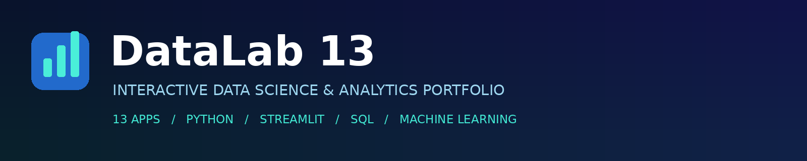
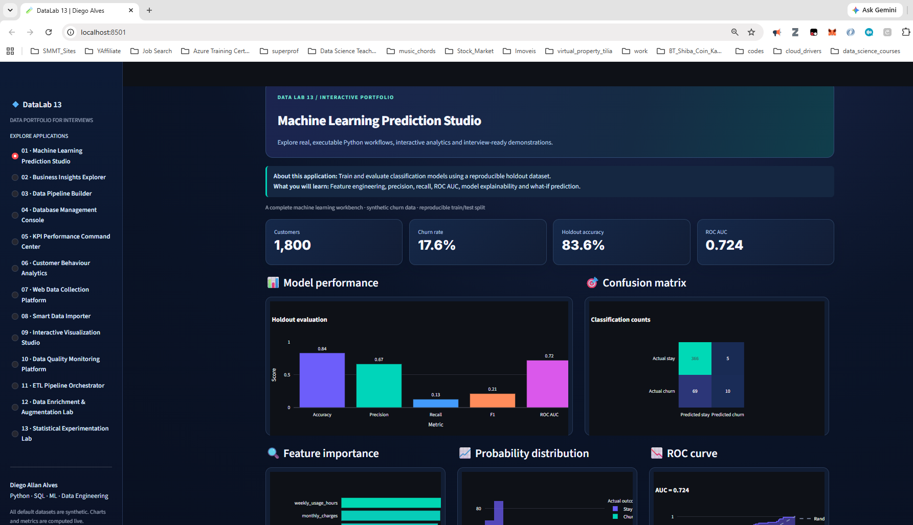

<div align="center">



# DataLab 13 — Interactive Data Portfolio

**13 hands-on Python applications for data science, analytics, engineering and statistics**

[](https://www.python.org/)
[](https://streamlit.io/)
[](https://plotly.com/python/)
[](https://github.com/diegoallanalves/DataLab_13_Dashboards)

**[View the source code](https://github.com/diegoallanalves/DataLab_13_Dashboards) · [Streamlit Community Cloud](https://share.streamlit.io/)**

</div>

---

## 👋 Meet the founder

<table>
<tr>
<td width="210" valign="top"></td>
<td valign="top">

### Diego Allan Alves
**Founder & Developer · Data Engineer · Data Scientist · AI/Data Product Builder**

I'm a Brazilian-British data professional with an MSc in Data Science from London South Bank University and professional experience in the UK across data engineering, analytics, cloud services and production support.

I created **DataLab 13** to make data concepts tangible: explore a dataset, run a pipeline, train a model, investigate data quality and explain the results in a business context.

**Core interests:** Python, SQL, data engineering, machine learning, BI, cloud and practical AI applications.

[GitHub profile](https://github.com/diegoallanalves) · [Email](mailto:diegoarpalves@gmail.com)

</td>
</tr>
</table>

> **A little personality, too:** I enjoy the outdoors and the coast. I believe curiosity, balance and creativity help us become better problem-solvers. The photo above is a real photograph, not an AI-generated portrait.

## ✨ What is DataLab 13?

A **Streamlit-based educational portfolio** of 13 interactive applications that demonstrate different stages of the data lifecycle—from collection and import to modelling, monitoring, visualization and experimentation.

- **Explore** sample data and interactive visualizations.
- **Build** basic ETL workflows and run SQL queries.
- **Train and evaluate** Random Forest or Logistic Regression churn models.
- **Inspect** data quality, distributions and business KPIs.
- **Learn** from explanations included inside each application.

> **Transparency:** The default customer dataset is synthetic. This repository is an educational portfolio/MVP, not a production cloud platform. Screenshots and conceptual designs are labeled separately below.

## 📸 Real dashboard preview — Machine Learning Prediction Studio

The screenshot below is taken from the **actual Streamlit application** (`app.py`) running on `localhost:8501`. It is not AI-generated.



The code behind this screen uses a reproducible **synthetic customer churn dataset (1,800 rows)**, a stratified train/test split, and a choice of **Random Forest or Logistic Regression**. Interactive controls include holdout test size, tree count and decision threshold. The module renders **accuracy, precision, recall, F1, ROC AUC, confusion matrix, feature importance, probability distribution, ROC curve, PCA visualization and what-if predictions**.

> This is the only actual module screenshot included in this package. Capture the other 12 screens from the running app before describing them as screenshots. No conceptual mockups are presented as implemented features.

## 🎨 Interface design

The application uses a **dark navy / teal Streamlit theme** with a left navigation sidebar, prominent KPI cards, Plotly visualizations and short **“About this application / What you will learn”** explanations for each module. The colors and layout are defined directly in `app.py`.

## 🧩 Explore the 13 applications

| # | Application | What it demonstrates |
|:--:|---|---|
| 🧠 01 | **Machine Learning Prediction Studio** | Train classifiers, compare metrics, examine ROC/confusion matrix, explore feature importance and try what-if predictions |
| 📊 02 | **Business Insights Explorer** | Filter business data, compare revenue and export insights |
| 🔄 03 | **Data Pipeline Builder** | Understand extract, transform and load steps |
| 🗄️ 04 | **Database Management Console** | Run SELECT/WITH queries against an isolated in-memory SQLite database |
| 📈 05 | **KPI Performance Command Center** | Track revenue, customers, conversion, segments and monthly trends |
| 👥 06 | **Customer Behaviour Analytics** | Compare customer segments and conversion behaviour |
| 🌐 07 | **Web Data Collection Platform** | Learn respectful scraping with purpose-built practice websites |
| 📥 08 | **Smart Data Importer** | Import CSV/JSON and inspect data quality |
| 🎨 09 | **Interactive Visualization Studio** | Build configurable charts and explore variables |
| 🛡️ 10 | **Data Quality Monitoring Platform** | Review missing values, duplicates, cardinality and quality summaries |
| ⚙️ 11 | **ETL Pipeline Orchestrator** | Run a simple ETL demonstration with SQLite |
| 🧬 12 | **Data Enrichment & Augmentation Lab** | Engineer features and explore K-Means clustering |
| 🧪 13 | **Statistical Experimentation Lab** | Compare test/control conversion rates and calculate uplift |

## 🧰 Technology stack

**Application:** Python, Streamlit  
**Data processing:** Pandas, NumPy  
**Analytics & ML:** scikit-learn, statistical analysis  
**Charts:** Plotly  
**Database demonstrations:** SQLite, SQL  
**Educational scraping:** Requests, Beautiful Soup  
**Quality & engineering:** pytest, Git, GitHub

See `requirements.txt` for the exact dependencies used by this release.

## 🚀 Quick start — run locally

### 1. Clone the repository

```bash
git clone https://github.com/diegoallanalves/DataLab_13_Dashboards.git
cd DataLab_13_Dashboards
```

### 2. Create a virtual environment

**Windows PowerShell**

```powershell
py -m venv .venv
.\.venv\Scripts\Activate.ps1
```

**macOS / Linux**

```bash
python3 -m venv .venv
source .venv/bin/activate
```

### 3. Install dependencies

```bash
python -m pip install --upgrade pip
python -m pip install -r requirements.txt
```

### 4. Start the app

```bash
python -m streamlit run app.py
```

Open **http://localhost:8501** and select a module in the sidebar.

### 5. Run tests (optional)

```bash
python -m pytest -q
```

## ☁️ Deploy on Streamlit Community Cloud

1. Push `app.py`, `core.py`, `scraping.py`, `requirements.txt`, `tests/` and this README/assets folder to GitHub.
2. Open **https://share.streamlit.io/** and sign in with GitHub.
3. Choose **Create app** → **Deploy a public app from GitHub**.
4. Set the repository to `diegoallanalves/DataLab_13_Dashboards`, branch `main` and main file `app.py`.
5. Deploy, then test each module and add the verified public URL near the top of this README.

**Important:** This README does not claim the Streamlit deployment is live until the actual URL is verified.

## 🌐 Web scraping — safe learning resources

The scraping module supports the following purpose-built educational websites:

| Website | Learning exercise |
|---|---|
| [Books to Scrape](https://books.toscrape.com/) | Extract book titles, prices and ratings |
| [Quotes to Scrape](https://quotes.toscrape.com/) | Extract quotes, authors and tags |

The app intentionally restricts live scraping to these learning domains. Respect site policies, avoid excessive requests and never collect private data without permission.

## 🧪 Project status and roadmap

**Current:** Source code for 13 educational Streamlit modules, synthetic sample data, dark styling and pytest-oriented test setup.

**Planned improvements:**
- More readable, consistent visualizations across all 13 modules
- Actual screenshots of the other 12 modules in this README
- PostgreSQL-backed history for data quality monitoring
- Stronger tests, CI workflows and deployment checks
- More advanced datasets and explanatory case studies

## 🤝 Feedback and contributions

Suggestions, bug reports and pull requests are welcome. Open an issue with the relevant module name, reproduction steps and screenshots when possible.

---

<div align="center">

**Built with curiosity by Diego Allan Alves**

*Data · People · Impact*

[⬆ Back to top](#datalab-13--interactive-data-portfolio)

</div>
